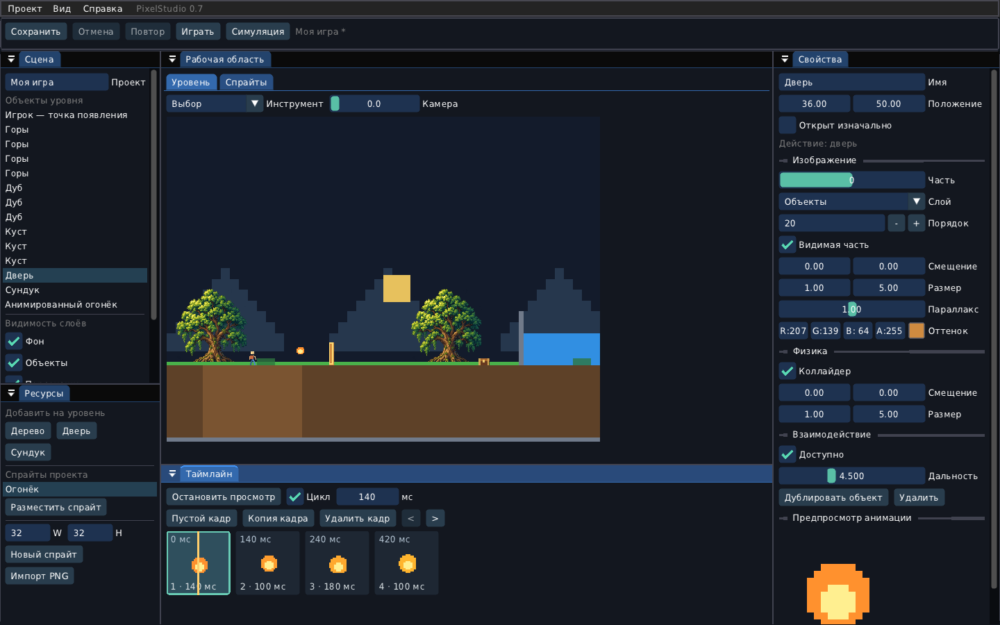
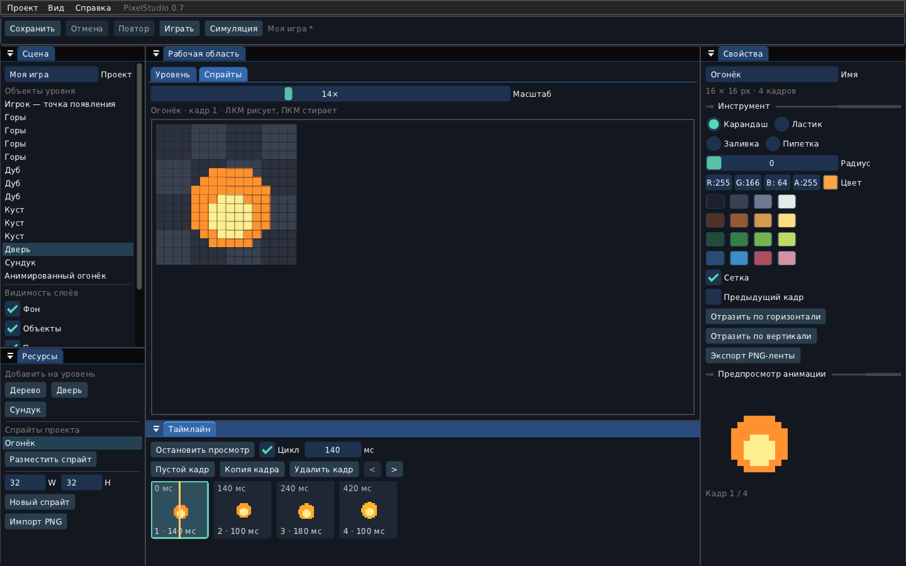

# PixelStudio 0.7 — редактор игр

PixelStudio — настольный редактор для Windows 10/11 x64 и Linux x86_64.
Он использует тот же движок и рендерер, что PixelSandbox. Интерфейс на русском.
Это первая рабочая версия: уровень, спрайты и покадровая анимация.

## Запуск

Распакуйте **весь архив**, включая assets, fonts внутри него и DLL.
Windows: `StartEditor.bat`. Linux: `chmod +x StartEditor.sh PixelEditor`,
затем `./StartEditor.sh`. Для игры остаётся `StartGame.bat` / `StartGame.sh`.

Linux: нужен SDL2 **2.0.18 или новее**, графический сеанс и glibc 2.31+.
Например Ubuntu 22.04+: `sudo apt install libsdl2-2.0-0`.
Один лишь низкий номер glibc не гарантирует совместимость старого SDL2 с IDE.
Windows-пакет включает SDL2.dll. Компилятор для запуска не требуется.

При первом запуске открыт пример: почва, бассейн, дубы, дверь, сундук и
анимированный огонёк. Ранее сохранённый проект по умолчанию открывается
автоматически. Новый проект создаётся через «Проект → Новый пример» с выбором
нового имени файла; существующий файл эта команда не перезаписывает.

В архив также включён отдельный пример: `examples/example.pxproj`.

## Панели

- **Сцена** — имя проекта, список объектов, точка появления игрока, видимость слоёв.
- **Рабочая область / Уровень** — просмотр, выбор и перенос объектов, кисть материалов и влажности.
- **Рабочая область / Спрайты** — пиксельный холст выбранного кадра.
- **Свойства** — параметры выбранного объекта или инструменты рисования.
- **Ресурсы** — готовые деревья, двери, сундуки и спрайты проекта.
- **Таймлайн** — кадры, длительности, перестановка и воспроизведение.

Панели можно закреплять, объединять во вкладки и менять их размеры внутри
одного окна. «Вид → Вернуть расположение панелей» восстанавливает исходную
компоновку. Расположение панелей действует в текущем сеансе.

## Уровень

Выберите объект мышью на уровне или в списке сцены. Перетащите его либо
задайте положение в свойствах. Шаг переноса — 1/8 клетки мира.
Кнопки «Дерево», «Дверь», «Сундук», «Разместить спрайт» добавляют экземпляр
в текущую область просмотра. Спрайт также можно перетащить из списка ресурсов
на уровень. Дублирование и удаление доступны в свойствах.

У частей объекта настраиваются слой, порядок, локальное смещение, размер,
параллакс, оттенок и видимость. Коллайдер имеет собственную геометрию.
Смена слоя не меняет коллизию. Переключатели слоёв управляют просмотром в IDE
и не меняют проект. Дверь и сундук имеют начальное состояние и дальность
взаимодействия; добавленные экземпляры работают независимо друг от друга.

В режиме «Материалы» ЛКМ рисует выбранным материалом, ПКМ стирает. Для воды
и газа задаётся количество. Режим «Влажность» меняет влажность только земли.
Мазок записывается в историю как одно действие. «Камера» сдвигает область
просмотра по горизонтали. Точка появления игрока редактируется через список
сцены; избегайте размещения внутри препятствий.

Мир в этой версии фиксирован: 128×72 клетки, нижняя строка закрыта.
Рисование — операция редактора, поэтому может создавать и удалять вещество.
Во время проверки игры редактирование исходного уровня отключено.

## Холст спрайтов

1. В ресурсах задайте W/H и нажмите «Новый спрайт» либо выберите существующий.
2. Откройте вкладку «Спрайты». Выберите кадр на таймлайне.
3. Выберите карандаш, ластик, заливку или пипетку в свойствах.
4. Рисуйте ЛКМ; ПКМ стирает независимо от выбранного инструмента.

Доступны палитра, произвольный RGBA-цвет, радиус кисти, масштаб, сетка,
полупрозрачный предыдущий кадр и отражение по горизонтали/вертикали.
Шахматный фон обозначает прозрачность. Мазок между отсчётами мыши соединяется
линией. Ctrl+Z/Ctrl+Y или кнопки «Отмена»/«Повтор» управляют историей.
При активном текстовом поле обычная отмена текста остаётся у поля.

До 32 спрайтов в проекте; каждый — до 128×128 пикселей и до 32 кадров.
Рисование выполняется в одном растровом слое на кадр. История хранит до
12 состояний и сокращается для больших проектов; это не неограниченная история.

## Таймлайн

Выберите кадр щелчком. «Пустой кадр» вставляет прозрачный кадр после выбранного,
«Копия кадра» копирует его изображение и длительность. Последний кадр удалить
нельзя. Кадры переставляются перетаскиванием или кнопками `<`/`>`.

Длительность выбранного кадра задаётся в миллисекундах: 1–60000 мс.
«Цикл» включает повтор. Просмотр анимации идёт в свойствах; выбранный для
рисования кадр при воспроизведении не переключается. Щелчок по кадру останавливает
предпросмотр и открывает этот кадр. Экземпляры спрайта на уровне используют
ту же анимацию. Все экземпляры начинают её с общей временной отметки.

## PNG

«Проект → Импорт PNG» открывает диалог с полем пути. Введите или вставьте
**полный путь**. Встроенного системного выбора файлов пока нет.
Можно импортировать одну картинку либо горизонтальную ленту с указанным
количеством кадров. Ширина должна делиться на число кадров, размер кадра —
не больше 128×128. Начальная длительность импортированных кадров — 120 мс.
Большой готовый дуб отображается в сцене, но не импортируется на маленький холст.

«Экспорт спрайта PNG» записывает все кадры горизонтальной лентой с прозрачностью.
Длительности, цикл и остальные данные сохраняются в .pxproj, а не внутри PNG.

## Проекты и запуск игры

Ctrl+S сохраняет проект. «Сохранить как» и «Открыть» позволяют указать другой
полный путь. Проект — один файл .pxproj с миром, персонажем, всей сценой,
изображениями кадров и длительностями. Нарисованные ресурсы встроены в файл.
Предустановленный oak.png и шрифт поставляются вместе с приложением.
При закрытии, создании или открытии другого проекта редактор предлагает
сохранить несохранённые изменения. Сохранение сначала пишет временный файл,
а затем заменяет целевой. Контрольная сумма обнаруживает повреждения данных.

Начальный путь проекта:

- Windows: `%APPDATA%\PaperGoose\PixelStudio\Моя игра.pxproj`.
- Linux: `~/.local/share/PaperGoose/PixelStudio/Моя игра.pxproj`
  (либо путь внутри XDG_DATA_HOME).

«Играть» создаёт копию уровня. A/D или стрелки — движение, пробел — прыжок,
E — взаимодействие. «Симуляция» запускает только физику мира. «Пауза» и «Шаг»
дают остановку и один такт. «Стоп» возвращает исходный уровень без переноса
изменений из игры в проект.

Отдельный запуск сохранённого проекта:

```sh
./PixelSandbox --project "/полный/путь/Моя игра.pxproj"
```

Windows:

```bat
PixelSandbox.exe --project "C:\Games\Моя игра.pxproj"
```

В этом режиме F5/F9 используют отдельное сохранение проекта в пользовательской
папке PixelSandbox; исходный файл .pxproj не перезаписывается. R возвращает
исходный уровень. Для обычной песочницы старые .pxs сохранения по-прежнему читаются.

## Сборка и проверка

Dear ImGui 1.91.9b docking и PNG-кодеки включены в исходники с лицензиями.
Достаточно C++17, CMake и SDL2 development 2.0.18+; сеть при сборке не нужна.
Обычные scripts/build-linux.sh и scripts/build-windows.sh собирают оба приложения.

```sh
cmake -S . -B build/local -DCMAKE_BUILD_TYPE=Release
cmake --build build/local --parallel 2
ctest --test-dir build/local --output-on-failure
./build/local/bin/PixelEditor
```

Только ядро: `-DPIXEL_BUILD_GAME=OFF -DPIXEL_BUILD_EDITOR=OFF`.
Только игра: `-DPIXEL_BUILD_EDITOR=OFF`. Есть и `make editor`, `make editor-test`.

Семь наборов CTest проверяют симуляцию, почву, сцену, сохранения, модель IDE,
игровую отрисовку и реальный интерфейс редактора. Editor smoke программно
нажимает элементы ImGui: холст, отмену/повтор, кадры, кисть уровня, запуск,
остановку и сохранение. Для него используется SDL_VIDEODRIVER=dummy.

```sh
SDL_VIDEODRIVER=dummy ./PixelEditor --smoke-test
SDL_VIDEODRIVER=dummy ./PixelSandbox --check-project "/путь/игра.pxproj"
```

## Изменения ядра и границы версии

AnimationClip выбирает кадр по времени независимо от частоты отрисовки,
поддерживает длительности кадров и остановку на последнем кадре.
Scene::replace проверяет весь объект до изменения, Scene::erase оставляет
неактивную запись, чтобы ID остальных объектов не менялись. Сериализация
сохраняет эти ID, визуальные части, анимации, коллайдеры и взаимодействия.
Ядро продолжает работать без SDL; SDL и ImGui нужны только приложениям.

Пока нет редактора кода, скелетной анимации, многослойного рисования,
произвольных сценариев поведения, упаковщика самостоятельной игры и расширения
мира за 128×72. Дверь пока останавливает персонажа, но не жидкости и газ.
Эти возможности следует добавлять следующими отдельными шагами.




